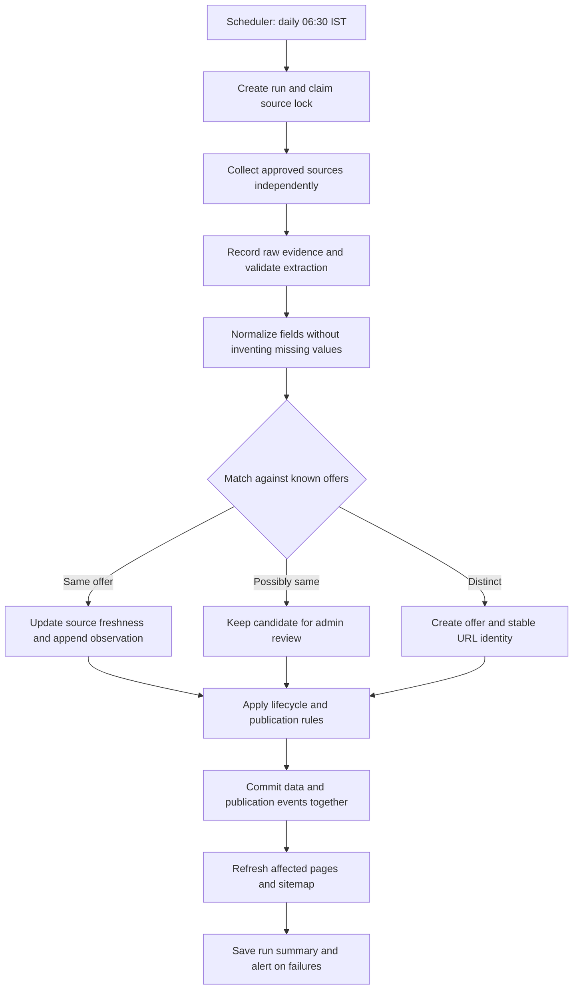

> Repository update: legacy calculator content has now been removed at the owner’s request. Start with AGENT-STEPS.md; its current repository status supersedes historical planning statements below. The public app is a non-indexable coupon placeholder. No collector or database has been implemented.

# Coupon Intelligence: implementation plan for your coding agent

Planning document, 29 October 2026. No application replacement or collectors have been implemented. Read the accompanying PROJECT-SPEC.md as the product specification. This plan explains daily operation, adds public-page and SEO policies, and provides ordered implementation tasks.

## 1. Decisions to carry into implementation

- Initial audience: Indian shoppers looking for Amazon India electronics offers. Other retailers and categories follow after the engine works.
- Keep the existing Next.js App Router, React, TypeScript and Tailwind 4 foundation. Use daisyUI 5 for component primitives and Hallmark for design direction and visual review. Installing a skill does not install the daisyUI application dependency.
- Build a separate Node.js collector process. The website reads stored data; page requests never trigger scraping.
- PostgreSQL 17 from the first database task, with the same engine and migration path in development, CI, staging and production. No later database conversion. Use isolated databases and credentials; see POSTGRESQL.md.
- Use Zod for boundary validation, Cheerio for permitted HTML sources, existing Playwright only when a permitted source requires JavaScript, and Vitest for deterministic tests. Pin compatible versions and retain lockfiles during implementation.
- Keep the guide's modular boundaries. A separate HTTP API service and an npm-workspace migration are optional later; Next.js route handlers can expose the initial public API. This adapts the suggested repository layout to the existing app without changing its engine-first sequence.
- One scheduler and one worker initially. No Redis, Kafka, Kubernetes, LLM extraction, checkout automation or public submissions in the production release.
- New offers create database records. One dynamic route renders any published offer; no source file or Git commit is generated for each coupon.

Assumptions: English first, India first; “GEO” means generative-engine/AI-search visibility. No brand name, production host, confirmed source permission, SEO traffic baseline or budget has been supplied. These do not block the foundation. Source access is a prerequisite for real collection; production hosting is a prerequisite for an unattended daily schedule.

## 2. What happens every morning

Recommended starting time: **06:30 Asia/Kolkata**, which is **01:00 UTC**. This is a proposed configuration, not a scheduled job already running. Source-specific frequency and request budgets can override this default.



Example, using invented test data only: Monday a source lists `EXAMPLE18` for one campaign. Tuesday that same listing is found again: one offer remains, its last-seen timestamp advances, and a new daily observation is stored. A second source describing the same proven campaign adds attribution to that offer. Wednesday a genuinely different campaign creates a new offer. A reused code for different products or dates is not automatically merged.

If a source fails Tuesday, Monday's records remain. Their freshness can become stale; a failed fetch does not establish expiration. A newly empty extraction from a formerly populated page is treated as suspicious until the adapter can prove it represents a valid empty result.

The scheduler only starts work. It does not decide duplicates, create routes, or mark verification. Those are separate engine responsibilities.

## 3. Small initial module layout

```text
app/                          existing Next.js app, replaced incrementally later
  stores/[storeSlug]/page.tsx
  categories/[categorySlug]/page.tsx
  offers/[offerSlug]/page.tsx
  search/page.tsx
  admin/...
  api/offers/route.ts
src/modules/
  domain/                     schemas, types, lifecycle and publication policies
  sources/                    adapter contract, registry, one adapter per source
  normalize/                  money, dates, retailer and category normalization
  deduplicate/                exact rules, candidate generation, review outcomes
  database/                   migrations and repository interfaces
  publish/                    page eligibility and transactional event outbox
  search/                     public read model and filtering
workers/collector/            CLI and orchestration, independent of Next.js
tests/fixtures/               permitted saved samples and synthetic fixtures
tests/integration/            complete repeated-run tests
docs/                         source register, architecture and operations
```

Do not create every file in one pass. Keep these modules independent enough to extract into npm workspaces when it provides a concrete benefit. The worker must not import Next.js rendering or cache APIs.

## 4. Source onboarding comes before a live adapter

The six names in your guide are candidates, not working integrations:

| Candidate | Initial action | Current state |
|---|---|---|
| Amazon India | Investigate official promotions, feeds and permitted reuse | Not investigated |
| GrabOn | Investigate API/feed/licensing and access rules | Not investigated |
| CouponDunia | Same source review | Not investigated |
| DesiDime | Review community content and reuse requirements | Not investigated |
| Zoutons | Investigate permitted integration | Not investigated |
| GoPaisa | Distinguish coupon, deal and cashback semantics | Not investigated |

Store each source's approved hostnames, access method, terms/permission evidence and review date, attribution requirements, page scope, request budget, timeout and enabled state. Check robots directives as an additional crawl control; robots allowance alone is not a republication licence. Prefer feeds/APIs. A blocked source remains unsupported; do not bypass authentication, CAPTCHAs or anti-bot controls.

The first milestone can run entirely on fixtures. Do not claim the product has live coupons until one approved real integration passes.

Prevent the collector from becoming an arbitrary URL fetcher: administrator-managed source allowlists, HTTPS, redirect validation at every hop, blocking private/link-local/metadata IP destinations, response-size limits and timeouts. Source pages are untrusted data; never execute their instructions or render their HTML without sanitization.

## 5. Data model: separate identity, evidence and publication

Use the original guide's stores, categories, sources, coupons, source listings, observations, runs and verification tables. Add these concepts:

| Concept | Reason |
|---|---|
| Stable public ID and immutable initial slug | An edited title must not change its URL |
| Lifecycle status | Active, expired, inactive, unknown; distinct from verification |
| Publication state | Draft, review required, published, withheld |
| Freshness state | Fresh or stale under a source-specific policy; distinct from expiry |
| Duplicate review case | Candidate IDs, rule version, evidence and resolution |
| Publication event outbox | Retry cache/search updates after committed writes |
| Source lock/lease | Prevent concurrent runs for the same source |
| Content update timestamp | Separate meaningful public changes from routine polling |

Money should be integer paise, percentages integer basis points, and timestamps UTC. Keep a source's raw date text and timezone interpretation alongside a parsed value. Unknown expiry stays null. An end date that is only a calendar date must use the source's documented business timezone, not the server's timezone.

The guide mixes expired/inactive outcomes into its verification examples. Preserve those outcomes in evidence history but expose lifecycle separately from assurance: a historically checkout-tested offer can now be expired. For production release, all collected offers are unverified unless a dated independent/manual record supplies stronger evidence. A source's “verified” badge remains a source claim.

Use PostgreSQL foreign keys, transactions and versioned migrations from the beginning. The adjacent `schema-example.sql` demonstrates constraints for source-listing identity, observation replay protection and publication outbox events; it is deliberately a foundation example, not the full production domain schema.

### Normalized extraction contract

This is a design example for the implementation agent, not integrated code:

```ts
type MatchOutcome = "SAME_OFFER" | "POSSIBLE_DUPLICATE" | "DISTINCT_OFFER";

interface ExtractedListing {
  sourceId: string;
  sourceListingKey: string; // source's stable listing ID when available
  originalUrl: string;
  observedAt: string;       // UTC ISO timestamp
  retailerId: string;
  title: string;
  offerKind: "CODE" | "AUTOMATIC" | "BANK" | "CASHBACK";
  code: string | null;
  discountBps: number | null;
  discountPaise: number | null;
  minSpendPaise: number | null;
  maxDiscountPaise: number | null;
  currency: "INR" | null;
  eligibility: Record<string, unknown>;
  validFrom: string | null;
  validUntil: string | null;
  rawEvidenceRef: string;
}

interface CollectionResult {
  listings: ExtractedListing[];
  completeness: "COMPLETE" | "PARTIAL";
  errors: Array<{ location: string; reason: string }>;
  snapshotAuthoritative: boolean;
}

interface SourceAdapter {
  sourceId: string;
  collect(ctx: {
    runId: string;
    signal: AbortSignal;
    requestBudget: number;
    timeoutMs: number;
  }): Promise<CollectionResult>;
}
```

Validate actual results with Zod before persistence. Missing required structural fields reject the listing; unknown optional commercial terms remain null. Preserve original values and normalization rule versions. Normalize codes only under known source/retailer case rules; do not assume every code is case-insensitive.

## 6. Deduplication: three separate checks

**Transport replay:** `(source_id, source_listing_key)` identifies a source listing. A listing-specific ID is important: a store page containing 40 coupons cannot use its page URL as every listing's identity. If no ID exists, derive a conservative source-specific key using stable listing fields, document its limitations and preserve aliases when matching improves.

**Observation replay:** `(collection_run_id, source_listing_id)` makes retries within one run idempotent. A later day's observation is intentionally a new history entry. If the source provides several versions in one run, choose one deterministically or introduce an explicit source-event/version key.

**Commercial identity:** different sources can describe one campaign. Match retailer, campaign/code identity, offer type, discount, minimum spend, cap, products, bank/card/customer restrictions and validity. Unknown conditions are not equal to “no restriction.” Similar titles only generate review candidates.

| Situation | Action |
|---|---|
| Same stable listing, unchanged campaign | Append observation; update freshness |
| Same listing, presentation corrected | Preserve offer identity; record content version |
| Same source listing reused for new campaign | Preserve old history; relink current listing to new offer |
| Cross-source, complete matching campaign evidence | One offer, multiple source listings |
| Same code but conflicting dates or bank/product restrictions | Separate or review; never merge on code alone |
| Automatic/no-code offers with partial conditions | Review; no global title-based uniqueness |
| Confirmed duplicate after publication | Choose survivor, retain evidence, 301 old URL to survivor |

Do not put a unique constraint on coupon code, title or a fingerprint containing unknown fields. Fingerprints accelerate candidate search; incomplete hashes do not prove equality. Cross-source conflicts must not overwrite official terms merely because another source was crawled more recently. Store field provenance and apply a documented authority policy; unresolved material conflicts require review.

### Worker orchestration pseudocode

```ts
async function processSource(source, scheduledSlot) {
  // Atomically claim source + slot; retries resume the same logical run.
  // Lock ownership is fenced and expires; heartbeat while fetching.
  const run = await runs.claim(source.id, scheduledSlot);
  if (!run.acquired) return;
  try {
    const result = await adapters[source.id].collect(run.context);
    for (const raw of result.listings) {
      const normalized = validateAndNormalize(raw);
      await database.transaction(async tx => {
        await tx.assertCurrentLockOwner(run.lockToken);
        const listing = await tx.upsertSourceListing(normalized);
        if (await tx.hasObservation(run.id, listing.id)) return;
        const match = await matcher.resolve(tx, normalized, listing);
        // Historical links stay with observations if the listing changes campaign.
        const offer = await persistMatch(tx, match, normalized, listing);
        await tx.appendObservation(run.id, listing.id, offer.id, normalized);
        await tx.applyPublicationPolicy(offer.id);
        await tx.enqueuePublicationIfPublicContentChanged(offer.id);
      });
    }
    // Reconcile absence only for proven complete, authoritative snapshots.
    // Absence alone does not set EXPIRED.
    await runs.complete(run, result);
  } catch (error) {
    await runs.failIfStillOwned(run, safeError(error));
  } finally {
    await locks.releaseIfOwned(run.lockToken);
  }
}
```

These names are contracts to implement, not existing methods. Do not hold database transactions open during network calls. A cancelled/expired worker cannot keep writing after another worker takes ownership. Validate that fencing behavior with a crash/recovery integration test.

## 7. Scheduling, failure recovery and publication

Local development starts manually. A single persistent Linux machine can use cron plus `flock` as a first deployment. Example only, after the agent implements and verifies the named CLI:

```cron
# Scheduler configured to UTC; 01:00 UTC = 06:30 India time.
0 1 * * * /usr/bin/flock -n /var/lock/coupon-collector.lock /opt/coupon/bin/collect-daily >> /var/log/coupon-collector.log 2>&1
```

Create those paths, permissions and log rotation during deployment; do not paste this into a server where they do not exist. The launcher must set the correct working directory, activate the pinned Node runtime and load secrets from the host's supported secret facility. `flock` only coordinates processes on the same machine. Multi-host operation requires database-backed ownership as described above.

A managed scheduler can launch the worker as an alternative; use the host's job interface and its concurrency controls. Avoid keeping a long scrape inside a serverless web request. Hosting choice remains open. Codex's onboarding dev server is not the production scheduler.

Operational rules:

- Start with one request at a time per source, then adjust within its approved budget. Apply request budgets to retries and pagination too.
- Bounded retries for transient failures, jittered backoff, honor Retry-After. Stop on persistent 401/403 or access challenges and flag the source.
- Use conditional requests with ETag/Last-Modified when supported. A legitimate 304 can advance successful source-check evidence without pretending a new page was extracted.
- Record each source's run independently. One failure does not roll back successful sources or erase the live catalogue.
- Alert on stale successful-run timestamps, repeated failures, unusual zero results, extraction rejection spikes, stuck runs and undelivered publication events. Thresholds depend on the configured schedule.
- Expire offers from reliable end-time evidence even if today's collection fails. A stale/unseen offer can be withheld under policy without falsely asserting it expired.
- Keep bounded raw-evidence retention and backups; redact credentials and personal data. Test restoring a database before public launch.

Commit offer changes and an outbox event in the same transaction. A publisher drains events and refreshes affected offer/store/category pages and search data. Failed deliveries retry idempotently, so a worker crash between commit and cache refresh does not hide new offers indefinitely.

For the first public version, server-render database reads with explicit fresh-read behavior. This avoids a caching dependency while correctness is established. Later add bounded caching/on-demand revalidation through an authenticated internal endpoint; verify APIs against the installed Next.js 16.3 docs. Revalidation must not be publicly triggerable and must accept only validated IDs/tags. A periodic reconciliation repairs missed events. Separate last-checked timestamps from content updates so polling alone does not trigger every page's cache or sitemap lastmod.

## 8. Public URLs and automatic new pages

```text
/                                      search and current offer discovery
/stores/                               stores with supported data
/stores/amazon-india/                  retailer hub
/stores/amazon-india/electronics/       curated retailer/category intersection
/categories/electronics/               category hub
/offers/amazon-electronics-<publicId>/  immutable offer URL
/guides/how-to-use-amazon-offers/       original, reviewed evergreen explanation
/methodology/                          collection, verification and freshness rules
/about/  /contact/  /corrections/  /privacy/
/search?q=...                          user search, excluded from index
/admin/...                            authenticated and excluded from index
```

Use `app/offers/[offerSlug]/page.tsx` to load by a stable ID embedded in the slug. If a known record has a wrong slug, redirect to its stored canonical URL. Unknown IDs return an actual 404. New eligible records appear through the same template immediately, with no rebuild required under the chosen fresh-read strategy. Do not statically freeze the catalogue to build-time `generateStaticParams`; if used as a pre-render optimization, retain runtime support for new records and test it.

Each published offer page includes: distinct title, code or automatic-offer action, quantified benefit only when known, minimum spend/cap, product and bank/account eligibility, source links, collection time, evidence status, known validity or “not provided,” redemption instructions and related useful offers. A code must not be the only content. Public text is rewritten for clarity from permitted facts, not copied wholesale from source descriptions.

New offer records do not automatically deserve indexed pages. All valid offers may be visible in appropriate lists, but an offer detail is indexable only after passing: enough reliable conditions to be useful, traceable evidence, no unresolved material conflict, no likely duplicate and a meaningful distinct purpose. Short records can stay on hubs or have noindex detail pages. Review a small initial batch manually before enabling automatic publication of matching-quality records.

Expiry policy: show an explicit expired banner and remove misleading CTAs. Keep an archived page if it has useful history; otherwise noindex it or retire it with 410 when intentionally removed. Redirect only to a true replacement/duplicate, not to an unrelated home or category page. Remove noindex/retired URLs from sitemaps. Expired and stale are different states.

## 9. SEO and GEO strategy

The opportunity is **more useful, evidence-backed pages**, not more permutations of the same coupon. No skill, schema or page count guarantees first position or AI citation.

### Search architecture

Start with one retailer hub, one meaningful electronics landing page, real offer details and three to five original guides addressing redemption, eligibility and bank-versus-code conditions. Only launch category/store intersections that have useful inventory or editorial value. Do not create every bank × city × store × category combination or monthly copies of evergreen URLs.

Have crawlable links from home to hubs to offers and back through breadcrumbs. Use a few relevant related links. Empty directories need a useful empty state and noindex until substantive; never fabricate inventory to fill them.

Server-render titles, metadata, primary content and crawlable links. Use unique titles and self-canonical URLs for indexable pages. Choose the production origin before generating canonicals; do not ship the current calculator brand's metadata accidentally. Search and arbitrary filter permutations should be excluded from the index. Paginated unique listing pages need their own URLs, self-canonicals and next/previous anchor links; do not canonicalize every page to page 1. Consolidate true duplicate sort/tracking variants to the base URL. A noindex directive must be crawlable for a crawler to observe it.

Create database-driven sitemaps containing only canonical, indexable, successful pages. Split by type and at the protocol limit of 50,000 URLs or 50 MB uncompressed; use a sitemap index when needed. lastmod comes from meaningful content/evidence changes, not each cron execution. Verify sitemap freshness after a new eligible record is added without rebuilding.

Use truthful Organization/WebSite, BreadcrumbList, CollectionPage/ItemList and Article markup where applicable. Offer markup may describe supported commercial facts, but a coupon aggregator is not automatically eligible for Product rich results or Merchant Center. Do not invent products, prices, aggregate ratings, review counts or validity. FAQs can help readers without promising a commercial site's FAQ rich results. Validate both Schema.org semantics and search-feature eligibility against current official guidance.

Performance targets at the 75th percentile of real visits: LCP ≤2.5 seconds, INP ≤200 ms, CLS ≤0.1. These are targets, not measured results for the proposed site. Keep critical data server-side, minimize client bundles, size images, use local optimized fonts where licensed, and avoid intrusive coupon popups. Use lab checks before launch and field data when sufficient visits exist.

### GEO: make facts understandable and attributable

- Put clear conditions and source/evidence dates close to the offer claim. “Observed on source” and “tested by us” must remain distinct.
- Publish collection and verification methodology, correction/contact routes and real author/reviewer information for guides.
- Answer useful questions directly: how to redeem, who is eligible, what is unknown, and why an offer may not apply. Use facts and readable tables rather than repetitive SEO text.
- Maintain server-rendered access for search crawlers and deliberately choose AI-search crawler policy. Search crawlers and model-training crawlers are separate; allowing a training bot is not proof of search inclusion. Recheck provider documentation when implementing robots/WAF policy.
- Treat llms.txt as optional documentation, not a Google ranking or AI-citation guarantee. No need for a special AI-only content stream.
- Later, original aggregate insights can distinguish this site: observed offer duration, source freshness and documented restriction changes. Publish only analyses supported by sufficient retained evidence and explain their limits.

### Phased search rollout and measurement

1. Foundation: verify metadata, rendering, crawlability and small-batch page quality; connect Search Console and Bing Webmaster after domain ownership is available.
2. Expansion: add useful inventory and reviewed guides; inspect indexed versus intended URLs and organic user actions.
3. Scale: add sources/categories only when duplicate and publication metrics stay healthy. Sample generated pages for factual accuracy, conflicts, thinness and template duplication.
4. Authority: improve methodology and first-party reporting; measure actual referral/citation observations without manufacturing outreach or testimonials.

Record baseline at launch, then review monthly. KPIs: source-run success, extraction completeness, incorrect-merge rate in reviewed samples, fresh-offer coverage, intended/indexed URL ratio, organic impressions/clicks, useful copy/view-offer actions, broken/expired-action reports, Core Web Vitals and observed AI referrals. Traffic, rankings, search volume and competitor authority are currently unmeasured; set growth targets after a real baseline.

Research GrabOn, CouponDunia, DesiDime, Zoutons and GoPaisa as candidate search competitors for the selected queries. This is a research list, not a completed live SERP comparison. Inspect actual Indian search results and page intent before selecting target keywords; do not invent volume or difficulty scores.

## 10. Professional design direction

Use Hallmark for a coherent visual system and daisyUI for accessible component building blocks. No rendered design has been produced in this planning step. The initial design brief is inferred from your request: trustworthy, restrained, easy to compare, aimed at mobile shoppers.

Suggested direction: warm neutral background, dark text, one deep green primary accent, generous spacing and restrained borders. Declare colors, typography and spacing through tokens. Choose locally hosted licensed typefaces or a system stack. Product/store imagery must be supplied or licensed; do not fabricate partnership logos.

The recognizable visual feature should be a compact **offer evidence panel**: benefit, required conditions, status meaning and source freshness visible together. Put store search and real current inventory first. Avoid a large marketing hero that pushes the actual offers off screen.

Design these representative screens before expanding templates:

1. Retailer listing, mobile and desktop: clear store name, labelled search/filters, offer list, honest status and next action.
2. Offer detail: readable conditions, one primary copy/view action, evidence panel and attribution.
3. Admin collection view: last successful source run, failed/partial state, duplicate-review queue and run diagnostics.

Use daisyUI primitives selectively: labelled inputs, buttons, breadcrumbs, tables or lists, pagination and badges with explanatory text. Read the installed usage/colors/component guides before writing JSX. Customize tokens rather than accepting an unrelated default theme. Honor focus-visible states, keyboard access, reduced motion, readable contrast and mobile touch targets. Copying a code should give accessible confirmation and a fallback; automatic offers use View offer, not Copy code.

Do not invent “verified today,” savings totals, customer counts or “popular” labels. Empty, loading, partial-source, expired and stale states belong in the design brief. Prioritize useful information density on catalogue/admin screens; marketing-page word-count heuristics are not product requirements for complete coupon conditions.

The implementation agent should read Hallmark's current workflow, show its design choices, build the representative screen first, and run its required visual lint/render review before expanding. No need to run a design build or delegate reviewers during this planning task.

## 11. Replace the current site deliberately

Your request authorizes planning the replacement, not deleting the application during this turn. Before an implementation milestone removes existing routes, produce a file-level replacement list. Preserve unrelated user changes.

Inventory current URLs and any available traffic/backlinks. Map a former URL to a 301 only when there is a genuinely equivalent new destination. Remove unrelated calculator routes with the appropriate retirement behavior rather than redirecting everything to the new home page. If the current site has never been public, document that instead of pretending there is migration equity.

Replace brand metadata, structured data, navigation, sitemap, robots rules and social previews together with the public transition. Keep staging authenticated or noindexed. Add a maintenance/failure plan and database backup before switching production. Whether to retain the current domain/brand is a launch decision; foundation work can proceed with a configurable public origin.

## 12. Milestones and acceptance gates

| Phase | Work | Must pass before moving on |
|---|---|---|
| 0 — Architecture | Read current repo, freeze scope, document module and replacement plan | Small file list, dependency choices and commands recorded; no route deletion |
| 1 — Foundation | Domain schemas, migrations, repositories, test runner and CI | Fresh database migrates; fixtures persist; build/typecheck/tests pass |
| 2 — One source | Source register, approved adapter, fixtures, CLI run history | Fixtures cover changed markup/errors; approved live collection works or external access limitation is explicit |
| 3 — Daily reconciliation | Idempotency, duplicate review, source ownership, lifecycle, outbox | Replay/concurrency/crash tests pass; source failure preserves catalogue |
| 4 — Admin | Authenticated run view, conflicts and duplicate review, manual evidence | Unauthorized access rejected; decisions audited; labels remain truthful |
| 5 — Public design/API | One polished retailer screen, detail screen, filtering and search | Browser journey works with real stored data; mobile/accessibility review passes |
| 6 — SEO/publication | Metadata, sitemap, URL policy, dynamic new records, performance | New eligible offer is reachable/indexable without rebuild; low-quality candidates stay excluded |
| 7 — Second source/deploy | Cross-source tests, host scheduler, backups, alerts and rollout | Second adapter needs no domain rewrite; daily run and crash recovery verified on target host |

Do not build all phases in one request. At each milestone, the agent states scope and acceptance criteria, implements only that milestone, runs checks, reports evidence and stops at the agreed boundary. Fixture-only completion does not satisfy the final live-source production release gate.

### Critical tests worth writing

- Same fixture twice on different days: one offer, one source listing, two observations.
- Same run retried: no duplicate observations, offers or publication events.
- Two approved sources with known matching terms: one offer and two listings.
- Same code with distinct eligibility or dates: separate offers or review, never a blind merge.
- Unknown minimum spend stays null and differs from a proven zero.
- A source reuses its listing ID for a new campaign: historical observations remain attached to the old offer.
- 403, timeout, partial pagination or suspicious empty extraction: no mass expiration or deletion.
- A job dies after commit but before publication: pending outbox event is recovered.
- Two jobs start together; lock expiry and takeover occur: only the current owner may persist.
- New eligible record appears on its public URL, relevant hub and sitemap without a rebuild.
- Draft/duplicate/unreliable records are not indexed or leaked through public APIs; admin endpoints require real authorization.
- Copy/view-offer browser journey and visible conditions work at mobile width with keyboard input.

## 13. First message to give your implementation agent

```text
Read docs/PROJECT-SPEC.md and
docs/IMPLEMENTATION-PLAN.md. Inspect the current Next.js
repository and its AGENTS.md before editing. Use the existing isolated checkout;
do not create a worktree unless requested.

Implement only Phase 1: domain foundation and persistence. Keep existing public
pages working. Before editing, state the exact file list and chosen database
library/migration approach. Keep modules independent of the frontend. Add Zod
schemas, PostgreSQL migrations, repositories, fixture data and Vitest integration
tests for null preservation, source-listing uniqueness and observation replay.
No live scraping, scheduled deployment, public redesign or route deletion yet.
Use the plan's SQL only as an illustrative starting point and complete its
missing domain tables and constraints. Do not use seed coupons as public facts.

Acceptance: fresh install, migration on empty DB and repeat migration, meaningful
tests, TypeScript, lint and Next.js build pass; existing pages still respond.
Keep credentials out of code. Report changed files, exact checks/results,
limitations and the next milestone. Stop after this phase.
```

Subsequent messages should name just the next phase and its gate from the table. For Phase 5, explicitly invoke the installed Hallmark and daisyUI skills; for Phase 6 invoke seo-plan, seo-programmatic and seo-geo. They guide the implementation; they do not replace the product specification or justify unmeasured ranking promises.

## 14. Skill status and evidence limits

- daisyUI installed at `/workspace/getpaidapp/.agents/skills/daisyui` for Codex. The initial planning stage read its root and install guides; daisyUI 5 has since been installed as part of the authorized cleanup.
- Hallmark installed globally at `/home/agent/.agents/skills/hallmark` for Codex. Read its design workflow; no design generated.
- From your SEO catalogue, installed `seo-plan`, `seo-programmatic`, `seo-geo` locally for Codex, and used them for strategy, URL/publication rules and AI-search guidance. Their other skills can be added when the corresponding audit is needed.
- The skills CLI omitted seo-geo's reference directory; copied the matching upstream references into that installed skill so its linked guidance is available.
- Skill thresholds and heuristic scores are internal review aids, not Google's ranking rules. No production SEO audit, competitive live analysis, traffic forecast, permission investigation or source crawl was performed here.
- Historical planning stage: only skills and the planning bundle were added. Subsequent owner-authorized cleanup replaced the legacy application with a coupon placeholder and installed daisyUI. See CLEANUP.md and PROGRESS.md for current status. `skills-lock.json` records project skill installations.

Reference guidance for the implementation agent: Google Search Essentials and helpful-content guidance, Google's AI search guidance, the sitemap protocol, and current Next.js docs shipped in `node_modules/next/dist/docs/`. Recheck current provider documentation for deployment and crawler controls rather than treating third-party skill text as verified platform behavior.
